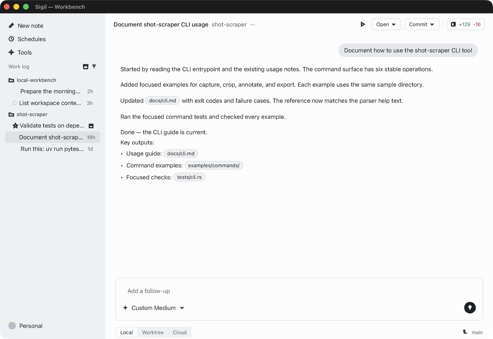

# Sigil

Desktop UI in Rust. One widget tree runs on three hosts. `sigil::run`
opens a window or, with the `terminal` feature, paints the tree on a
character grid. `Host` embeds the tree in another engine's loop.



[docs/api.md](https://raw.githubusercontent.com/manaforged/sigil/main/docs/api.md)
lists every exported item with its signature in one plain-text file.

## Status

0.1 is an early release. The API will break between minor versions until
1.0. The markdown, HTML, SVG, and mermaid parsers are not hardened for
untrusted input; they have been fuzzed only briefly. Report bugs on
[GitHub issues](https://github.com/manaforged/sigil/issues).

## Requirements

- Rust 1.90 or newer.
- A wgpu-capable GPU for the default desktop renderer.
  Set `SIGIL_BACKEND=cpu` to use the CPU renderer. The terminal host needs no GPU.

## Platforms

| Host | Linux | macOS | Windows | Web (`wasm32`) |
| --- | --- | --- | --- | --- |
| Window `run` | yes (wgpu or `SIGIL_BACKEND=cpu`) | yes | yes | yes (WebGPU, or CPU into a 2D canvas) |
| Embed `Host` | yes | yes | yes | yes |
| Terminal `run` (feature `terminal`) | yes | yes | yes | no |

No mobile host.

## Install

Sigil is not on crates.io yet. Add the Git dependency:

```toml
[dependencies]
sigil-ui = { git = "https://github.com/manaforged/sigil" }
```

The package is `sigil-ui` because the `sigil` name is taken on
crates.io. The library is `sigil`, so imports read `sigil::`. The first
build compiles the wgpu stack and can take a few minutes.

For a terminal-only program:

```toml
[dependencies]
sigil-ui = { git = "https://github.com/manaforged/sigil", default-features = false, features = ["terminal"] }
```

To pack release builds, install the `sigil-pack` tool:

```bash
cargo install --git https://github.com/manaforged/sigil sigil-sign
```

To sign packages from your own code, add
`sigil-sign = { git = "https://github.com/manaforged/sigil" }`; see
[Signing](docs/guide/signing.md).

## Usage

```rust,no_run
use sigil::prelude::*;

fn main() -> sigil::AppResult<()> {
    sigil::run(AppConfig::new("Sigil - hello-counter").size(480, 240), app_tree)
}

fn app_tree() -> impl IntoNode {
    let count = signal(0_i32);
    column()
        .layout(LayoutStyle::default().padding(32.0))
        .bg(Token::Surface)
        .child(text(move || format!("Count: {}", count.get())))
        .child(button("Increment").primary().activate(move || count.update(|n| *n += 1)))
}
```

`sigil::run` opens the window and drives the frame loop. Pass
`AppConfig::new(title).terminal()` to run the same tree in the terminal.
An embed host pumps `Host` inside `Runtime::scope`. To run the
examples, clone this repository and run:

```bash
cargo run -p sigil-ui --example hello-counter                        # the app above
cargo run -p sigil-ui --example hello-host                           # embed the tree
cargo run -p sigil-ui --example hello-terminal --features terminal   # terminal host
```

## Cargo features

The [`sigil-ui` README](crates/sigil/README.md#features) lists every
feature. `desktop` is the default. `terminal` adds the terminal host.

## Limits

- Headless machines run the terminal host and the test suite. The
  window host needs a GPU adapter, unless `SIGIL_BACKEND=cpu` selects
  the CPU renderer. `auto` is the default; `wgpu` requires an adapter.
- No mobile host. The web host has no system fonts, no clipboard
  paste, and no accessibility tree, and it runs tasks on the page's
  one thread; see [Web host](docs/guide/web.md).
- The terminal host has no rounded corners and no shadows. It composes
  CJK input through the terminal's own input method.
  Images render through the terminal graphics protocol on Kitty,
  Ghostty, WezTerm, Konsole, iTerm2, Warp, and Sixel terminals. Other
  terminals show sextant glyphs.
- Fuzz targets are in progress. Read [SECURITY.md](SECURITY.md) before
  you pass untrusted documents to the markdown, HTML, or SVG parsers.
- `sigil-pack macos` ad-hoc codesigns unless you pass a signing
  identity. Ad-hoc signing is not Developer ID or notarization.
- A form can show a doubled label after save and reopen (issue #1).

## API health

Generated by `cargo truesight health`. Stories are the example programs
named `story-*`; each counts the Sigil names it uses.

<!-- truesight:health sigil-ui -->

| Measure | Value |
| --- | --- |
| surface | 3304 items in 36 modules: 444 types, 251 functions, 1238 methods, 520 fields, 790 variants, 61 constants; 510 aliases |
| app tier | 179 prelude names; budget 179 |
| journeys | 8 journeys, 8 at budget: story-01-hello 6/6, story-02-counter 13/13, story-03-form 19/19, story-04-todo 24/24, story-05-nav 17/17, story-07-async 19/19, story-08-component 14/14, story-09-test 8/8 |
| documented | 718 of 718 module-level items (100%): 0 by rustdoc, 718 by reference docs |
| doc paths | 106 reference rows name paths that are not public |
| findings | 0 deny, 0 warn |

<!-- /truesight -->

## Docs

| Read | For |
| --- | --- |
| [User guide](docs/guide/README.md) | Task pages in reading order. Build the book with `mdbook serve docs`. |
| [Troubleshooting](docs/guide/troubleshooting.md) | No GPU, images in tmux, and terminal colour. |
| [GUI and TUI](docs/guide/hosts.md) | Build for the window, the terminal, or both; host-only APIs; how to split host code. |
| [Recipes](docs/guide/recipes.md) | Keys, theme switching, layout, streaming, timers, terminal hooks, and screen readers. |
| [API map](docs/api.md) | Every exported item with its signature and an example. Plain Markdown for tools too. |
| [Architecture](docs/guide/arch/overview.md) | How it works inside. |

The [changelog](CHANGELOG.md) lists each release.

## Security

Report vulnerabilities by email to [thomas@manaforge.tech](mailto:thomas@manaforge.tech).
[SECURITY.md](SECURITY.md) lists the other reporting channel and each
input surface.

## Contributing

Issues are welcome. Pull requests are by invitation: open an issue
first, and send a patch only when asked. See
[CONTRIBUTING.md](CONTRIBUTING.md) for the build and the gate.

## License

[MIT](LICENSE-MIT). Copyright (c) 2026 Thomas Gardiner.
