# Component gallery

This gallery is the image library for Sigil documentation and the future
`sigil-ui.com` website. Each image comes from a real Sigil widget rendered
through the offscreen wgpu path at 2× scale.

Run this command from the repository root to refresh every image:

```sh
cargo test -p sigil-ui --test catalog -- --ignored --test-threads=1
```

Review every changed PNG before you commit it. These images show the current
component output. They are not hand-built mockups.

## Light theme

### Buttons

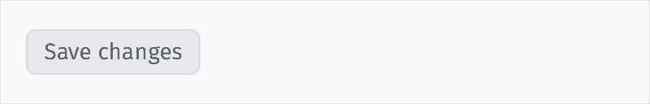

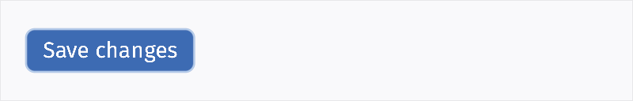

### Status and progress

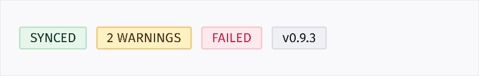

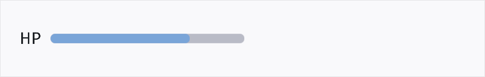

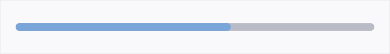

### Form controls

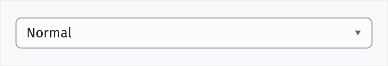

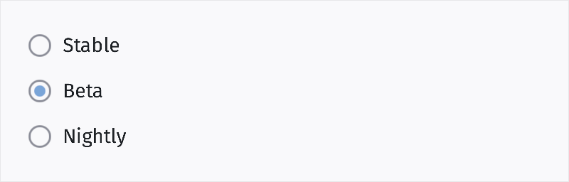

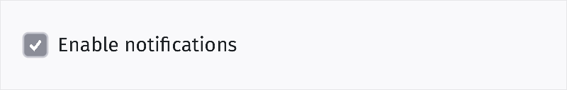

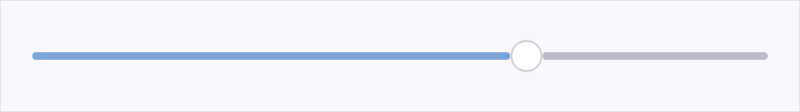

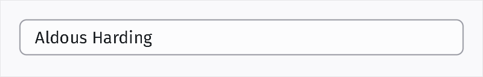

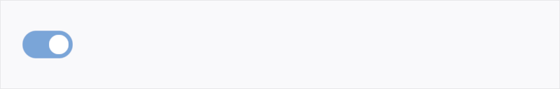

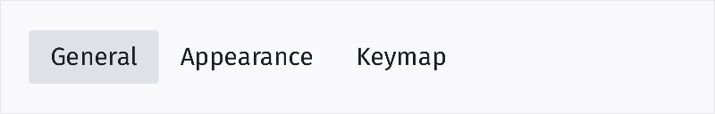

## Dark theme

### Buttons

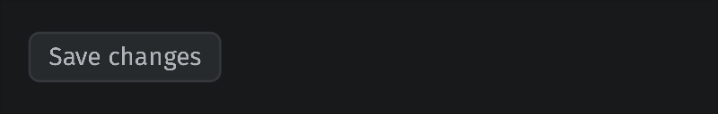

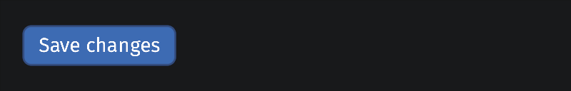

### Status and progress

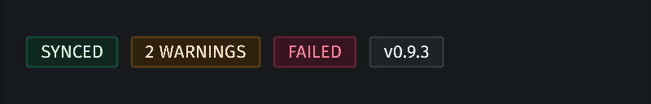

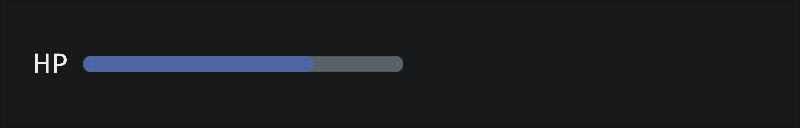

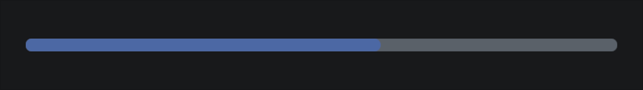

### Form controls

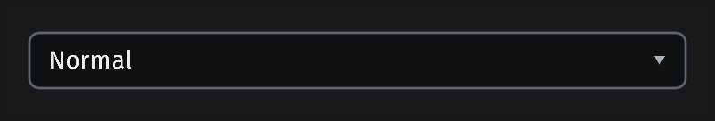

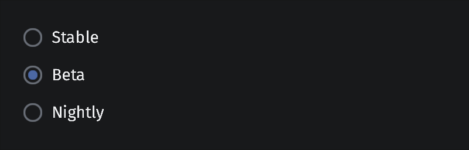

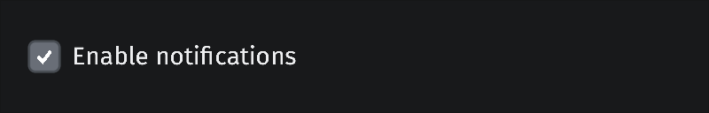

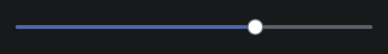

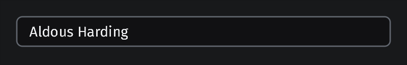

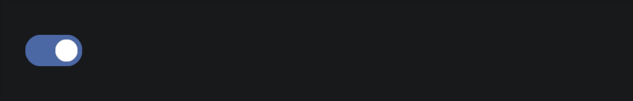

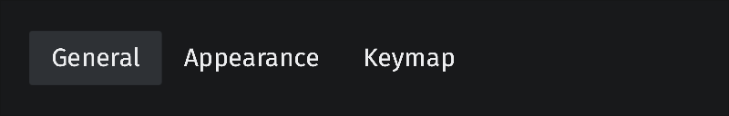

The capture definitions live in `crates/sigil/tests/catalog.rs`. Add a new
entry there when a component is ready for the public gallery. Keep the output
name stable so documentation and website links do not break.
